# Pix

AI 生图平台 Pix：登录用户输入提示词，调用自托管 ComfyUI 生成一张图并显示。Web（模板本体）+ 机器侧（`machine/` 目录，ComfyUI + 代理 Docker 镜像），域名 pix.oneboy.app。

- **前端**：公开侧包含首页、登录、注册、找回密码与初始化页；登录后左侧为可折叠可调宽侧栏（带菱形 Logo 与「工作台」），个人资料 / 系统管理 / 设置 / 关于收在顶栏头像菜单里（首字圆头像）。支持 PWA 主屏安装与中英双语。
- **后端**：提供生图调度、机器侧 ComfyUI 代理接入与鉴权、中文提示词 Workers AI 自动翻译、R2 历史图库存储，以及多因子鉴权、注册审核、邮件发送与系统管理。

## 界面预览

以下截图取自本仓的界面（中文、亮色为主，另附暗色与移动端）。公开首页包含项目名、一句话说明与登录入口；登录后侧栏为响应式工作台，个人资料 / 系统管理 / 设置 / 关于从顶栏头像菜单进入；初始化页按数据库状态呈现初始化与已关闭形态。

<p align="center">
  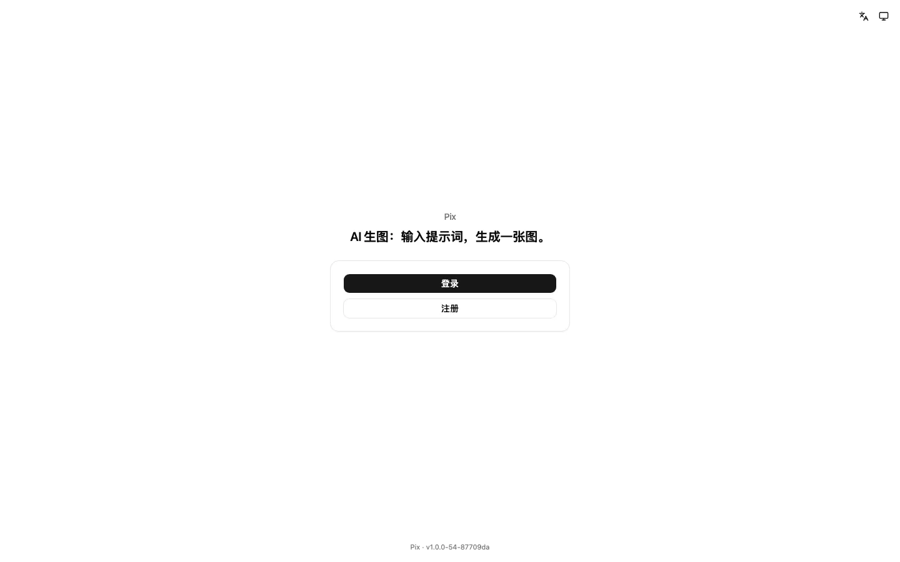
</p>

| 登录                                                                                                                          | 两步验证                                                                                                                       |
| ----------------------------------------------------------------------------------------------------------------------------- | ------------------------------------------------------------------------------------------------------------------------------ |
| 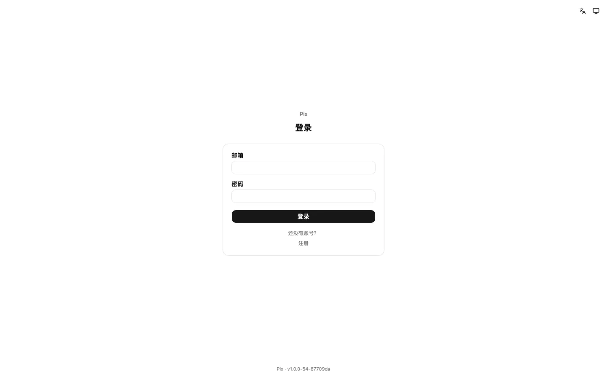 |  |

| 工作台                                                                                                                                                                                                                                            | 系统管理·用户管理                                                                                                                                                         |
| ------------------------------------------------------------------------------------------------------------------------------------------------------------------------------------------------------------------------------------------------- | ------------------------------------------------------------------------------------------------------------------------------------------------------------------------- |
| 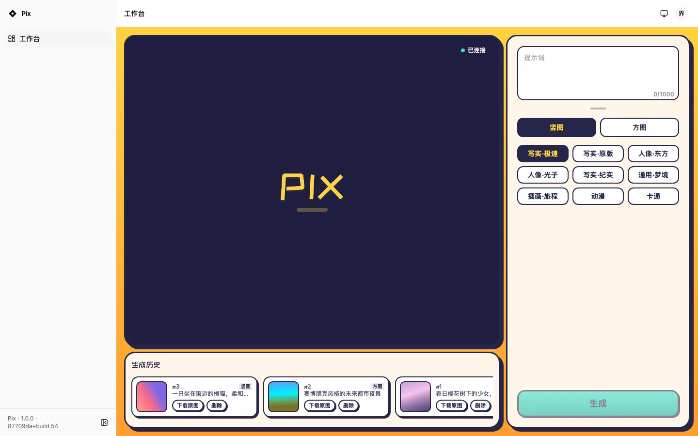 | 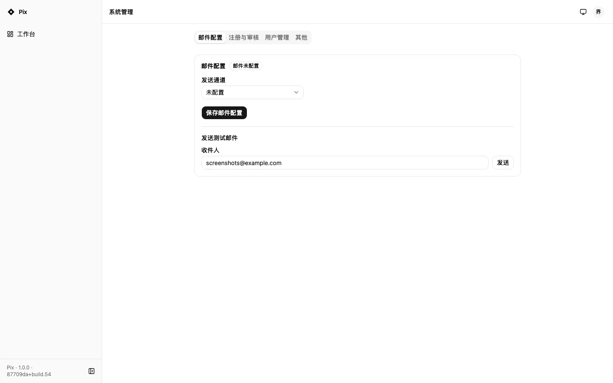 |

| 个人资料                                                                                                                            | 设置·偏好                                                                                                                                         |
| ----------------------------------------------------------------------------------------------------------------------------------- | ------------------------------------------------------------------------------------------------------------------------------------------------- |
| 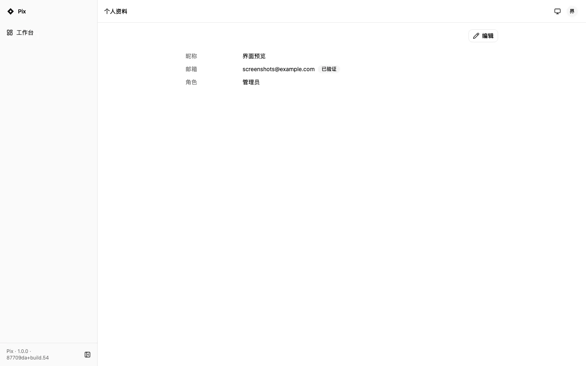 | 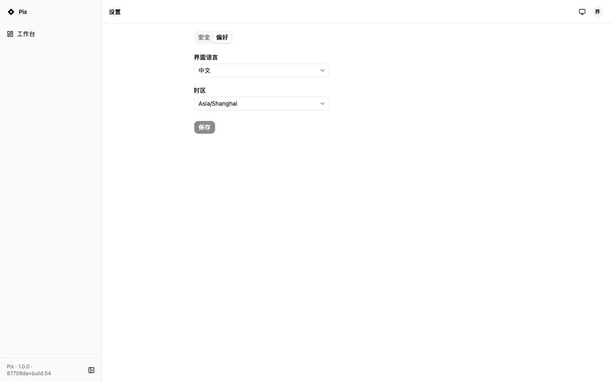 |

| 初始化                                                                                                                    | 关于                                                                                                                           |
| ------------------------------------------------------------------------------------------------------------------------- | ------------------------------------------------------------------------------------------------------------------------------ |
| 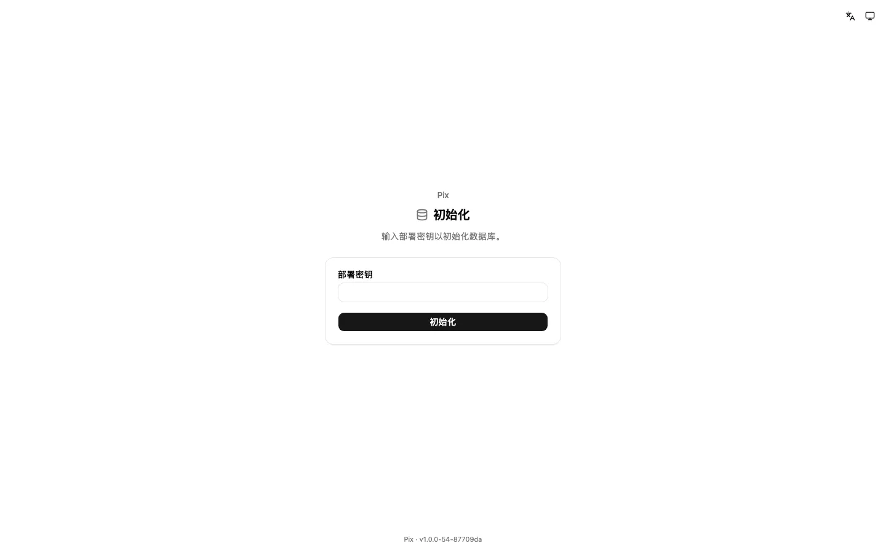 | 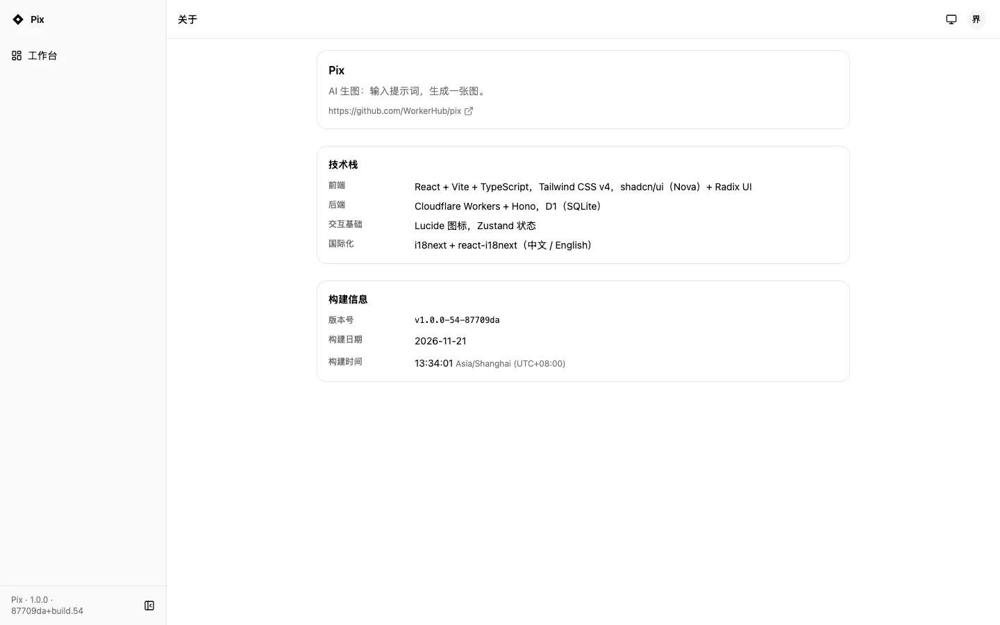 |

| 注册                                                                                                                           | 找回密码                                                                                                          |
| ------------------------------------------------------------------------------------------------------------------------------ | ----------------------------------------------------------------------------------------------------------------- |
| 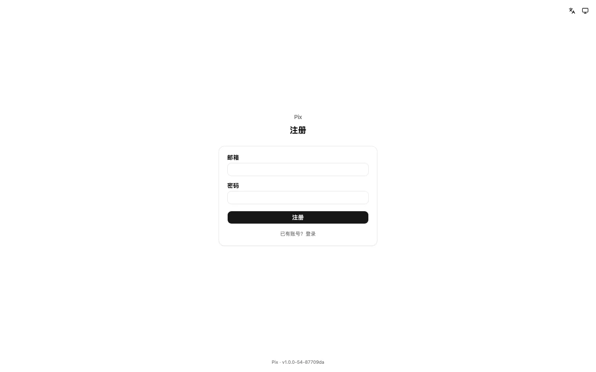 | 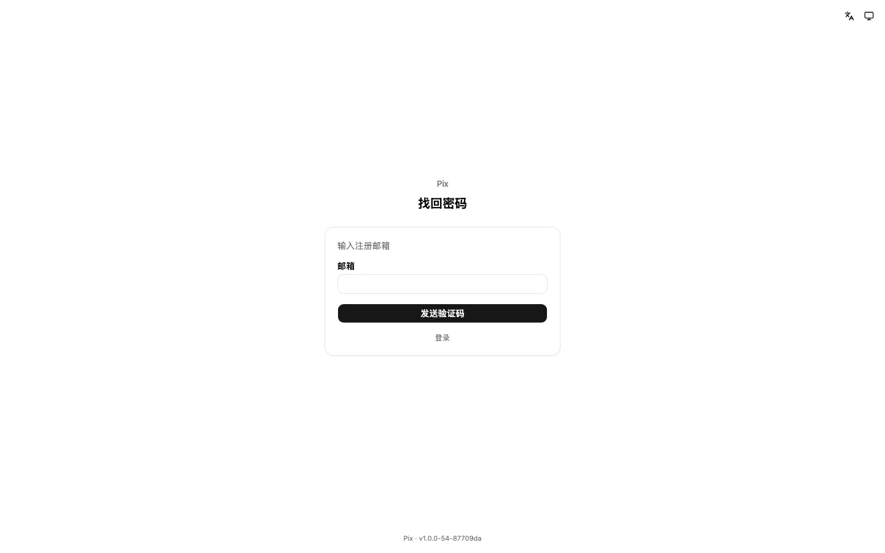 |

<p align="center">
  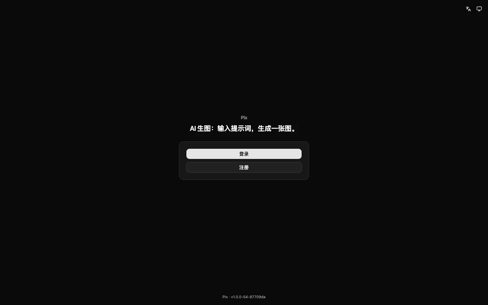
  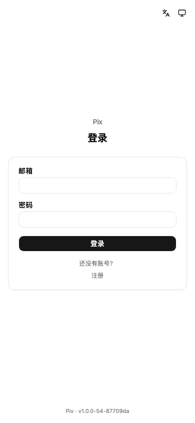
  
</p>

## 功能特性

- **AI 生图**：ComfyUI 驱动，内置 SD 1.5 九款精选模型（写实·极速、写实·原版、人像·东方、人像·光子、写实·纪实、通用·梦境、插画·旅程、动漫、卡通），模型悬停提供风格介绍与特性说明，支持竖图（512×768）与方图（512×512）两种常用尺寸。
- **极速生成**：LCM-LoRA 加速加持，普通 CPU 机器约 100 秒即可出图；标准模式约 4 分钟。
- **中文提示词自动翻译**：输入包含中文时自动调用 Workers AI（`@cf/meta/m2m100-1.2b`）翻译为英文提示词后送入生图管线，翻译失败自动回退原文。
- **生图历史**：生成图片持久化存入 Cloudflare R2，每张图片带全局编号、生成时间、所用模型与真实生成耗时（按 ComfyUI 实际执行时间戳计量），支持灯箱原图查看与删除。
- **一屏工作台**：桌面端一屏布局不滚动，移动端支持 PWA 添加至主屏幕，实时显示机器连接状态指示与生成等待耗时进度。
- **机器服务分离**：生图任务调度至自托管机器的 `pix-service` 容器（ComfyUI + 鉴权代理）执行，经私有链接接入、无需暴露公网端口、共享密钥签名鉴权。
- **账号与系统管理**：支持开放注册与管理员审批、多因子认证（密码 + TOTP / Passkey / 邮箱验证码）、邮件双通道（SMTP / Resend）与用户角色管理。

## 技术栈

| 层     | 选型                                                                                                   |
| ------ | ------------------------------------------------------------------------------------------------------ |
| 前端   | React + Vite + TypeScript，Tailwind CSS v4，shadcn/ui（Nova）+ Radix UI，Lucide，Zustand，react-router |
| 后端   | Cloudflare Workers + Hono，D1（SQLite），WebAuthn（`@simplewebauthn/server`），otpauth                 |
| 国际化 | i18next + react-i18next（中文 / English），邮件模板双语                                                |
| 邮件   | `cloudflare:sockets` 原生 SMTP，或 Resend HTTPS API                                                    |
| 工程   | pnpm workspace，Biome，Vitest，Wrangler，GitHub Actions                                                |

## 目录结构

```text
.
├─ .github/
│  ├─ assets/imgs/            # README 截图（WebP，kebab 命名）
│  └─ workflows/              # ci / deploy / tag / release
├─ scripts/                   # build-info / check-identity / materialize-secrets / resolve-table-prefix
├─ web/                       # React + Vite 前端
│  └─ src/                    # pages / components/ui / lib / stores / locales
├─ worker/                    # Hono Worker
│  ├─ src/config/project.ts   # 项目身份单点
│  ├─ src/config/defaults.json # 默认表前缀（worker 与 scripts 共读）
│  ├─ src/db/schema.sql       # 与 src/lib/schema.ts 逐字同步
│  ├─ src/lib/                # 表前缀、迁移 runner、setup、设置
│  ├─ src/core/               # 鉴权、会话、验证码、限流、waker 开关
│  ├─ src/services/           # 邮件（SMTP / Resend）、定时任务桩
│  ├─ src/routes/             # auth / 2fa / setup / admin / me / public / waker
│  └─ test/                   # vitest（真实 SQLite 内存库跑迁移与接口契约）
├─ biome.json
├─ package.json
├─ pnpm-workspace.yaml
└─ tsconfig.base.json
```

## 本地开发

前置：Node（版本要求见根 `package.json` 的 `engines`）与 pnpm（见 `packageManager`）。

```bash
pnpm install
cp worker/.dev.vars.example worker/.dev.vars   # 填 SETUP_SECRET / SIGNING_SECRET
pnpm dev
```

`.dev.vars` 里两把密钥分别生成、不得复用：

```bash
openssl rand -base64 32   # SETUP_SECRET
openssl rand -base64 32   # SIGNING_SECRET
```

- `SETUP_SECRET`：setup 页与 `POST /api/setup` 的 `X-Setup-Secret`。缺失、为空或仍是 `*_PLACEHOLDER` 时，setup 接口 500 失败关闭。
- `SIGNING_SECRET`：两步登录 tempToken、Passkey 挑战 Cookie、邮件验证码哈希的签名钥。缺失时这些端点 500 失败关闭，其余功能不受影响。
- `TABLE_PREFIX` 可选：不写 → 默认前缀；写空值 → 无前缀；其他值 → 规范化后使用。本地不要写 CI 侧的保留字 `none`。
- `WAKER_SIGNING_KEY` 可选，见「定时任务与 waker」。

`pnpm dev` 先构建一次前端，再同时起 worker（`wrangler dev`，默认 8787）与 Vite（`/api` 反代到 8787）。也可以分开跑：单独跑 `pnpm dev:web`；单独跑 `pnpm dev:worker` 前要先 `pnpm build:web`——wrangler 直接托管 `web/dist`，目录不存在会启动失败。

### 首次初始化

1. 打开 `/setup`，输入 `.dev.vars` 里的 `SETUP_SECRET`，点「初始化」：跑迁移，回显生效表前缀与迁移记录。
2. 点「注册首个用户」（或打开 `/register`）建账号：首个用户自动成为管理员并直接批准。
3. 之后 setup 页默认关闭；管理员可在「系统管理 → 其他」重开页面。后续数据库升级由部署流水线自动调用 `POST /api/setup` 执行增量迁移；`POST /api/setup` 纯升级端点只跑迁移，不会建用户、改密码或删数据。

初始化也可以直接用 curl（把 `<SETUP_SECRET>` 换成 `.dev.vars` 里的值，密钥只放请求头）：

```bash
curl -X POST http://127.0.0.1:8787/api/setup \
  -H "X-Setup-Secret: <SETUP_SECRET>"
```

本地数据只存在本机 D1（`worker/.wrangler/state`）。本仓不带示例业务数据；要清空本地库（含验收账号与设置）：

```bash
rm -rf worker/.wrangler/state
```

## 测试与校验

```bash
pnpm lint           # Biome 代码检查
pnpm format:check   # Biome 格式检查，不改文件；要自动重排跑 pnpm format
pnpm typecheck      # web + worker 类型检查
pnpm test           # worker 与 web 单测（vitest）
pnpm build          # 前端产物 + worker 类型构建
pnpm check:identity # 项目身份令牌校验（白名单外零残留）
pnpm check:deploy   # 先 build:web，再 wrangler deploy --dry-run（不联网、不写线上资源）
```

`.github/workflows/ci.yml` 在 PR 与 main push 上逐条跑这些检查。

## 邮件与验证码

- 在「系统管理 → 邮件配置」里三选一：`none`（默认，未配置）/ `smtp` / `resend`。同一时刻只有一个生效，不做双通道或自动故障转移。
- SMTP 走 `cloudflare:sockets`：465 端口隐式 TLS，其余端口 STARTTLS；服务器不支持 STARTTLS 却配了账号密码时拒绝发送。Resend 走 HTTPS API，错误原文回显在测试邮件结果里。
- 凭据只写不读：接口只回「已设置 / 尚未设置」，保存时留空表示不改。
- 「邮件是否可用」只有一个判断：provider 为 `none`、SMTP 缺 host 或 Resend 缺 API key 都算未配置。未配置时登录页不显示「忘记密码？」，「注册需验证邮箱」不能开启（前端置灰、后端拒绝）；开关已开后渠道被清空时按未配置处理，不会把新注册用户锁死。
- 验证码：6 位数字、只存哈希、10 分钟有效、单个验证码最多试 5 次、用后即废、60 秒重发冷却，按邮箱与 IP 双限流；邮件按收件账号语言（找回密码按请求语言）发中英双语模板。

## 定时任务与 waker

- `worker/wrangler.toml` 的 `[triggers] crons` 是唯一的原生定时入口（默认每天一次）；任务本身只有一个 no-op 日志与 D1 抢占示例，生成项目后往里加自己的 job。
- 触发方式只由 `WAKER_SIGNING_KEY` 一个变量的取值决定，没有第二个模式开关：
  - 未配置（含空值、`*_PLACEHOLDER`）→ 原生 Cron 跑；
  - `false`（小写，保留值）→ 两个入口都不跑；
  - 配了 waker 给的 key → waker 回调接管（`/_waker/execute` 验签），Cron 入口自行跳过。
- 接入 waker 只配这一把 GitHub Secret。要彻底停掉原生 Cron 时把 `crons` 显式置为 `[]`，不要整段删除 `[triggers]`（Cloudflare 会保留已有 cron）。

## 密钥与数据

- 仓库里只有占位符与键名：`worker/wrangler.toml` 不含真实 ID，`.dev.vars` 与 `build-info.json` 已 gitignore，README 不写任何密钥值。
- 线上密钥只走 GitHub Secrets：部署时 `scripts/materialize-secrets.mjs` 把它们写进 `$RUNNER_TEMP/secrets.json`（权限 0600），再经 `wrangler deploy --secrets-file` 上传；脚本只打印键名，不打印值。
- 本仓不含示例业务表与种子数据；验收 / 截图用的账号只在本机 D1，清空方式见「本地开发」。

## 部署指南

### 前置要求

- Cloudflare 账户，已开通 Workers、D1 与 R2（R2 首次使用需在控制台启用；Workers AI 原生可用，无需额外开通）。
- GitHub 账户，用来把仓库 fork 到自己账号下（部署工作流在 fork 出的仓库里运行）。
- 自托管机器（本地服务器或云服务器，建议配置至少 4 核 CPU / 8GB 内存 / 20GB 磁盘，已安装 Docker 与 Docker Compose），用于运行生图机器服务 `pix-service`（若暂不生图可先只完成 Web 部署）。
- 只有本地开发才需要本机装 Git、Node.js 22 或更高版本与 pnpm（`corepack enable` 会自动使用仓库锁定的 pnpm 版本）；线上部署由 GitHub Actions 完成，无需本地环境。

### 1. Fork 仓库

打开 <https://github.com/WorkerHub/pix>，点击右上角 **Fork**，fork 到自己的 GitHub 账号下，保持公开或私有均可。以后要同步上游更新，在 fork 仓库首页点击 **Sync fork**。

fork 出来的仓库工作流默认未启用，需要先手动开启：

- 打开 fork 仓库的 **Actions** 标签页，按页面提示点击 **I understand my workflows, go ahead and enable them**（中文界面：「我已了解我的工作流，继续启用」）。
- 启用后，即可在 **Actions → Deploy → Run workflow** 手动触发部署流水线。

### 2. 创建 Cloudflare 资源

**D1 数据库**（存储用户、系统配置与生图记录元数据）

- 打开 Cloudflare 控制台 → Storage & Databases → D1 SQL Database → Create database，数据库名填 `pix`（可自定义）。
- 创建后进入数据库详情页，记下 **Database name** 与 **Database ID**，第 3 步配置时使用。
- Pix 的数据表默认带 `pix_` 前缀，因此可以安全复用已有的 D1 数据库，不会与同一数据库中的其他项目冲突。

**R2 存储桶**（存储生成的图片文件）

- 打开 Cloudflare 控制台 → Storage & Databases → R2 Object Storage → Create bucket，存储桶名称固定为 `pix-images`（对应 `worker/wrangler.toml` 中的 `IMAGES` 绑定），创建即可。

**Workers AI**

- Pix 通过 Workers AI 调用 `@cf/meta/m2m100-1.2b` 模型实现中文提示词自动翻译，属于 Cloudflare 平台原生绑定，无需手动创建独立资源。

### 3. 配置 GitHub Secrets 与 Variables

打开 fork 仓库的 Settings → Secrets and variables → Actions。机密凭证与资源 ID 放入 **Secrets**（GitHub 自动掩码保护），非机密的库名与前缀放入 **Variables**。若在组织内已有共享的 Cloudflare 凭证，亦可直接复用组织级配置。

**Secrets**（切换到 Secrets 标签页 → 点击 New repository secret 逐项添加）

| Secret                  | 必填 | 用途                                                                                                                                                |
| ----------------------- | ---- | --------------------------------------------------------------------------------------------------------------------------------------------------- |
| `CLOUDFLARE_API_TOKEN`  | 是   | Cloudflare API Token。可在 Cloudflare 控制台创建，推荐使用「Edit Cloudflare Workers」模板，并确保包含 Workers Scripts 编辑、D1 编辑与 R2 编辑权限。 |
| `CLOUDFLARE_ACCOUNT_ID` | 是   | Cloudflare 账户 ID（控制台首页右侧 Overview 中可直接复制）。                                                                                        |
| `D1_DATABASE_ID`        | 是   | 第 2 步中创建或复用的 D1 Database ID。                                                                                                              |
| `SETUP_SECRET`          | 是   | 初始化数据库及后续部署自动迁移的鉴权令牌，任意随机字符串（建议 32 字符以上）。                                                                      |
| `SIGNING_SECRET`        | 是   | 用于两步登录 tempToken、Passkey 挑战与验证码哈希签名的密钥，建议 32 字节随机字符串。                                                                |
| `PIX_SERVER_URL`        | 否   | 绘图机器服务的私有访问地址（例如 `https://pix-service.example.internal`），部署好第 7 步机器服务后填入；未配置时 Web 页面将提示机器离线。           |
| `PIX_SERVER_SECRET`     | 否   | 与绘图机器代理服务共享的鉴权密钥（须与机器侧 `.env` 中的 `PIX_SERVER_SECRET` 一致），部署机器服务后填入。                                           |
| `WAKER_SIGNING_KEY`     | 否   | **可选**。接入 waker 定时调度时的回调验签密钥。未配置时走 Worker 原生 Cron 触发；配置为 `false` 可关闭定时任务。                                    |
| `PAT_TOKEN`             | 否   | **可选**。手动打版本 tag 的工作流（`tag.yml`）推送用，一般日常部署无需配置。                                                                        |

**Variables**（切换到 Variables 标签页 → 点击 New repository variable）

| Variable           | 必填 | 用途                                                                                                                                   |
| ------------------ | ---- | -------------------------------------------------------------------------------------------------------------------------------------- |
| `D1_DATABASE_NAME` | 是   | D1 数据库名称（明文非机密，与创建时填写的名称一致）。                                                                                  |
| `TABLE_PREFIX`     | 否   | 数据库表前缀。未配置或留空默认为 `pix_`；填 `none` 表示无前缀；填其他值（如 `mypix`）将规范化为 `mypix_`。生效前缀必须在初始化前确定。 |

**不用终端生成密钥**：在浏览器任意标签页按 F12 打开 Console 控制台，运行以下代码获取 44 字符 base64（32 字节）：

```js
btoa(String.fromCharCode(...crypto.getRandomValues(new Uint8Array(32))))
```

或运行以下代码获取 64 位 hex：

```js
Array.from(crypto.getRandomValues(new Uint8Array(32)), (b) =>
  b.toString(16).padStart(2, "0")
).join("")
```

`SETUP_SECRET` 与 `SIGNING_SECRET` 只要求具备高强度随机性，以上两种结果均可使用。习惯命令行的用户亦可使用 `openssl rand -base64 32`。

部署脚本 `scripts/materialize-secrets.mjs` 会在流水线构建前严格校验上述必需项，若有缺失或仍为占位符将立即终止部署，绝不以空值上线。

### 4. 部署

进入 fork 仓库的 **Actions → Deploy → Run workflow** 手动触发部署（后续每次向 `main` 分支 push 代码也会自动触发）。

部署工作流依次执行：安装依赖 → 校验并解析 secrets 与 `wrangler.toml` 配置 → 构建前端产物 → `wrangler deploy` 部署至 Cloudflare Workers → 自动调用 `POST /api/setup` 运行数据库增量迁移并校验账本。

### 5. 初始化数据库

初次部署成功后，Worker 与前端页面即已就绪。在浏览器中打开部署完成的站点域名：未初始化时会自动跳转至 `/setup` 初始化页。

1. 输入第 3 步中配置的 `SETUP_SECRET`（密钥仅在请求头 `X-Setup-Secret` 中传输，绝不暴露于 URL）。
2. 点击「初始化」，系统将创建全量基线数据表并记录迁移账本，页面回显当前生效的表前缀及迁移列表，请核对前缀符合预期。

**可选命令行方式**：习惯命令行的用户也可以通过 curl 执行初始化，输入不回显且不进历史记录：

```bash
read -rs SETUP_SECRET
curl -X POST https://<你的站点域名>/api/setup \
  -H "X-Setup-Secret: $SETUP_SECRET" \
  -H "Content-Type: application/json" \
  -d '{"language":"zh"}'
unset SETUP_SECRET
```

初始化完成后 setup 功能自动关闭。后续每次部署由流水线自动完成数据库增量升级，页面与接口均不设删表或清库入口。

### 6. 注册管理员

初始化完成后，点击「注册首个用户」（或直接访问 `/register`）注册账号。首个注册用户将自动提权为管理员、直接激活并批准；此后的普通注册默认处于待批准状态，需管理员在「系统管理 → 用户管理」中审核批准。若在「系统管理 → 邮件配置」中配置了发信通道，还可开启注册邮箱验证码校验。

### 7. 部署绘图机器服务

Pix 采用前后端分离与计算密集型生图分离架构。生图计算跑在自托管机器（本地或 VPS）的 Docker 容器中，Worker 通过私有反代或内网通道调度机器，原始 ComfyUI 端口绝不公网暴露。

**1. 准备机器配置与 Compose 文件**

在绘图机器上创建运行目录，获取 `machine/` 目录下的配置文件：

```bash
mkdir -p /data/docker/pix-service && cd /data/docker/pix-service

# 下载 docker-compose.yml 与 .env.example
curl -fsSL https://raw.githubusercontent.com/<你的 GitHub 账号>/pix/main/machine/docker-compose.yml -o docker-compose.yml
curl -fsSL https://raw.githubusercontent.com/<你的 GitHub 账号>/pix/main/machine/.env.example -o .env
```

编辑 `.env` 文件：

- 将 `PIX_SERVER_SECRET` 设置为强随机密钥（务必与第 3 步中的 GitHub Secret 一致）。
- 默认代理端口为 `8190`，容器内 ComfyUI 仅监听 `127.0.0.1:8188`，对外仅暴露经过鉴权的代理端口 `8190`。

**2. 启动服务与模型自动拉取**

```bash
docker compose up -d
```

服务基于预构建镜像 `ghcr.io/workerhub/pix-service:latest` 启动。容器首次运行时会自动按固定哈希校验下载 SD 1.5 基础模型与 LCM-LoRA 权重，并在容器内离线合并为加速模型（模型文件持久化挂载至宿主机 volume）。可以通过日志查看下载与合并进度：

```bash
docker compose logs -f
```

**3. 健康检查验证**

等待服务就绪后，在机器本地测试健康检查端点（需携带 `X-Pix-Secret` 请求头）：

```bash
curl -H "X-Pix-Secret: <你的 PIX_SERVER_SECRET>" http://127.0.0.1:8190/health
```

返回包含 `{"status":"ok",...}` 即表明代理与 ComfyUI 服务正常运转。

**4. 关联 Web 服务**

- 为绘图机器的 `8190` 端口配置访问通道（推荐使用 Cloudflare Tunnel、Tailscale 或内网专线穿透，切勿无密码暴露公网）。
- 将穿透后的服务完整 URL（如 `https://pix-service.yourdomain.com`）与前面配置的共享密钥，分别填入 GitHub 仓库 Secrets 的 `PIX_SERVER_URL` 与 `PIX_SERVER_SECRET`。
- 重新触发一次 GitHub Actions Deploy 工作流更新 Worker 配置。部署完成后打开 Pix 网页工作台，右上角机器状态将变为绿色的「已连接」，即可开始体验极速 AI 生图。
